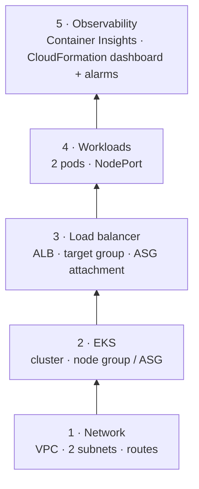

# EKS and AWS platform with Terraform

A real AWS platform, built layer by layer with **Terraform and CloudFormation**:
a VPC, an **EKS** cluster with a managed node group (an **Auto Scaling group**), an **Application Load Balancer** in front of it, a workload, and **CloudWatch** observability.
Every push to `main` builds it, verifies it end to end, and destroys it.

[Live pipeline →](https://danielkojomegbenu.com/projects/aws-eks-terraform)

## The layers



| Layer | Built with | What it is |
|---|---|---|
| 1 · Network | Terraform `modules/network` | VPC with two public subnets in two Availability Zones, tagged for EKS and load balancers. No NAT gateway, so runs stay cheap |
| 2 · EKS | Terraform `modules/eks` | EKS 1.37 with API access entries, and a managed node group of 2 × `t3.small` (min 2, max 3), which is an Auto Scaling group |
| 3 · Load balancer | Terraform `modules/edge` | An ALB and target group, **attached to the node Auto Scaling group**, so every node the ASG launches is registered automatically |
| 4 · Workloads | `kubectl` + `k8s/app.yaml` | Two replicas spread over the nodes, on NodePort 30080 |
| 5 · Observability | Terraform `modules/observability` + **CloudFormation** `cloudformation/observability.yaml` | The Container Insights EKS add-on, plus a CloudFormation stack with the CloudWatch dashboard (requests, 5xx, healthy nodes, node CPU, pods) and three alarms |

## The pipeline

| When | Steps |
|---|---|
| Pull request | Validate (`terraform fmt`, `validate`, `cfn-lint`), then `terraform plan`. Nothing is created |
| Push to `main` | The same checks, then builds layers 1 to 5 in order, **verifies**, and **destroys** everything, even if a step failed |

**Verify** (`scripts/verify.sh`) checks four things:
- A request through the load balancer reaches the pods (HTTP 200).
- Every node in the Auto Scaling group is a healthy target.
- The Container Insights add-on is `ACTIVE`.
- The dashboard and all three alarms exist.

## See a broken template stop the run

Open the pull request **demo/broken-alarm**. It gives one CloudWatch alarm in the CloudFormation template an invalid comparison operator.
**Validate** fails on `cfn-lint`, so the run stops before anything is planned, let alone built or paid for.

## Set it up in your own account

1. Create the IAM role GitHub Actions uses. It can only create roles named `eks-platform-*` and attach the AWS-managed policies EKS needs:
   ```bash
   cd bootstrap && terraform init && terraform apply
   ```
   Change `github_sub_prefix` and `state_bucket` first.
2. Change the state bucket in `terraform/main.tf`, then push.

## What's in the repo

| Path | What it is |
|---|---|
| `terraform/` | The root module and one module per layer |
| `cloudformation/observability.yaml` | The CloudWatch dashboard and alarms |
| `k8s/app.yaml` | The workload |
| `scripts/verify.sh` | The end-to-end check |
| `bootstrap/` | The OIDC role, applied once by hand |
| `.github/workflows/platform.yml` | The pipeline |

## Cost

About **$0.20 per run** on `main`: roughly 30 minutes of the EKS control plane ($0.10 an hour), two `t3.small` nodes, an ALB and Container Insights metrics. Nothing is left running between runs. Pull requests are free.
